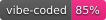

# freak-cogs

[](https://github.com/cens0r3d/freak-cogs/actions/workflows/bandit.yml)
[](LICENSE)
[](https://github.com/Cog-Creators/Red-DiscordBot)
[](https://github.com/Rapptz/discord.py)
[](.github/.vibecode)
[](https://vibecoded.fyi/)

Red-DiscordBot cogs by [cens0r3d](https://github.com/cens0r3d).

Most of the code was written together with DeepSeek, then reviewed, tested against a
running bot and fixed by hand.

## Install

```
[p]repo add freak-cogs https://github.com/cens0r3d/freak-cogs
[p]cog install freak-cogs <cog>
[p]load <cog>
```

## Cogs

| Cog | What it does |
| --- | --- |
| [vcstatus](vcstatus/README.md) | Status lines on voice channels, with a live member count. |
| [kickalerts](kickalerts/README.md) | Kick.com livestream alerts, plus a stream summary with peak and average viewers. |
| [tiktokwatch](tiktokwatch/README.md) | TikTok livestream and clip alerts. |
| [voicesay](voicesay/README.md) | Sends an audio attachment as a native Discord voice message. |
| [micwatch](micwatch/README.md) | Moves members who keep their mic open into a quarantine channel. |
| [naminter](naminter/README.md) | Checks a username against 700+ sites. |
| [osint](osint/README.md) | Passive lookups for IPs, domains, ASNs, URLs and files. |
| [sherlockosint](sherlockosint/README.md) | Archived fork: username search over the Sherlock site list. |
| [twitterfixer](twitterfixer/README.md) | Archived fork: turns Twitter/X links into vxtwitter embeds. |
| [idlerpg](idlerpg/README.md) | idlerpg.net as a Discord game — level up by idling. |
| [discogs](discogs/README.md) | Discogs browser: releases, masters, artists, labels, prices. |
| [bandcamp](bandcamp/README.md) | Bandcamp browser: search, discographies, tracklists, lyrics. |
| [goabase](goabase/README.md) | Goa/Psytrance party feed from goabase.net. |
| [dbd](deadbydaylight/README.md) | Dead by Daylight data: killers, survivors, perks, items, maps. |
| [psychonaut](psychonaut/README.md) | PsychonautWiki reference: substance class, doses, duration, effects. |

Every cog folder has its own README with the full command list, setup steps and troubleshooting.

## Requirements

Red-DiscordBot 3.5.0+ and discord.py 2.x; `naminter` needs Python 3.11+.
Some cogs want extra permissions, `ffmpeg`, or API credentials — each cog README says which.

## Credits

- **goabase.net** — the party data, published under
  [CC BY-SA 2.0](https://creativecommons.org/licenses/by-sa/2.0/). The share-alike
  credit is carried in every party embed.
- **tombly** — original author of TwitterFixer.
- **unnamed** — original author of SherlockOSINT.
- **DeepSeek** (`deepseek-v4.1-flash`) — pair-programmed the cogs.

## License

MIT — see [LICENSE](LICENSE).
